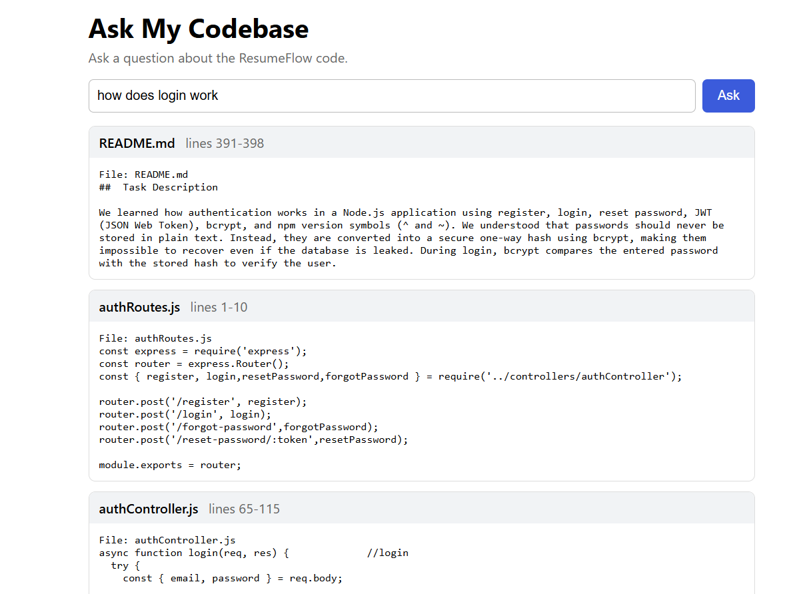
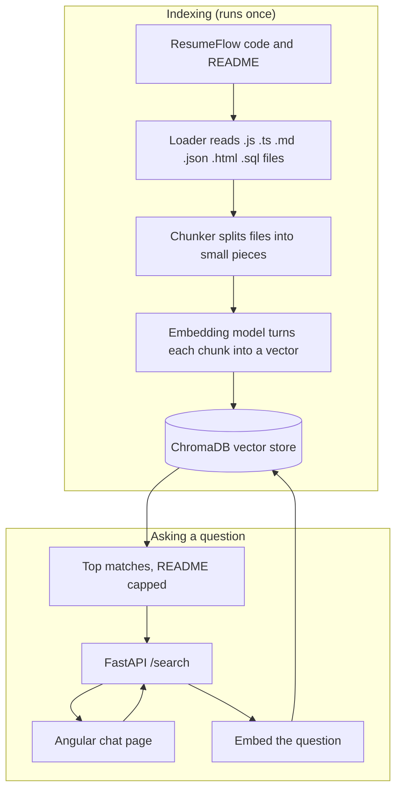

# Ask My Codebase

A search tool that lets me ask questions about my own code in plain English and get back the exact files and lines that answer them.

I built it on top of my ResumeFlow backend. Instead of digging through folders to remember where login or export is handled, I type "how does login work?" and it shows me `authRoutes.js` and `authController.js` with line numbers.





## Why I built this

I wanted a project that mixed ML with full-stack work, and I wanted to learn how retrieval systems (the "R" in RAG) really behave instead of just calling a library. So I built the search part myself, measured how well it works, and tried to improve the number.

## How it works



In plain words:

1. **Load**: a script walks through the project and reads the code files, skipping `node_modules`, `dist` and `.git`.
2. **Chunk**: each file is cut into smaller pieces, because searching a whole file is too vague. I kept the file name and line numbers for every piece so results can point back to the source.
3. **Embed**: every chunk is converted to a vector with `all-MiniLM-L6-v2`. It runs on my laptop and costs nothing.
4. **Store**: the vectors go into ChromaDB.
5. **Search**: a question is embedded the same way, and the closest chunks come back.
6. **Show**: a FastAPI endpoint returns the matches, and an Angular page displays them with file names and line ranges.

## What I tried to improve

My first version worked, but the results felt off. Long README sections kept showing up and pushing the real code out of the top results. So I tested two ideas:

- **Code-aware chunking.** Instead of cutting every 30 lines (which splits functions in half), I split at function, route and heading boundaries and put the file name at the top of each chunk.
- **README cap.** I fetch 15 results and keep at most one README chunk in the final 5.

## Results

I wrote 26 questions about my own code, each with the file that should answer it. A question counts as a hit if the correct file appears in the top 5 results (hit rate@5).

| Setup | Hit rate@5 |
|---|---|
| Naive chunking (every 30 lines) | 69% (18/26) |
| Code-aware chunking | 73% (19/26) |
| Naive chunking + README cap | 77% (20/26) |
| **Code-aware chunking + README cap** | **85% (22/26)** |

What I take from this: both changes help, and they help more together than alone. The README cap made the bigger difference, and code-aware chunking mostly paid off once the README noise was gone.

**Honest limits:**
- 26 questions is a small set, so one question moves the score by about 4 points.
- I wrote the questions and the expected files myself. Some of the misses may be wrong labels rather than search failures, and I'm still checking them.
- Questions about `package.json` still fail, because a list of package names is hard to match against prose.

## Tech stack

- **Search and ML:** Python, sentence-transformers (`all-MiniLM-L6-v2`), ChromaDB
- **API:** FastAPI, Uvicorn
- **Frontend:** Angular
- **Tested on:** a Windows laptop with 8 GB RAM and no GPU, so everything here is light enough for a normal machine

## Project structure

```
ask-my-codebase/          (Python: search and API)
  loader.py               reads the code files
  chunker.py              naive chunking, every 30 lines
  chunker2.py             code-aware chunking
  search.py               builds the index, searches, README cap
  api.py                  FastAPI /search endpoint
  eval.py                 my 26 test questions and the hit rate
  compare.py              builds the code-aware index
  compare2.py             compares all four setups

ask-ui/                   (Angular: chat page)
  src/app/                app.ts, app.html, app.css, app.config.ts
```

## How to run it

You need Python 3.12, Node and the Angular CLI.

**1. Set up the Python side**

```
git clone https://github.com/Codewhizz01/ask-my-codebase
cd ask-my-codebase
python -m venv venv
venv\Scripts\activate
pip install torch --index-url https://download.pytorch.org/whl/cpu
pip install langchain chromadb sentence-transformers fastapi uvicorn python-dotenv
```

**2. Point it at your code.** Open `loader.py` and change `REPO_PATH` to the folder you want to search.

**3. Build the indexes**

```
python search.py
python compare.py
```

The first run downloads the embedding model (about 90 MB). Type `exit` to leave the search prompt.

**4. Start the API**

```
uvicorn api:app --reload
```

Check it at http://127.0.0.1:8000/docs

**5. Start the chat page** (in a second terminal)

```
cd ask-ui
npm install
ng serve
```

Open http://localhost:4200 and ask a question.

**To reproduce my numbers:** `python compare2.py`

## What's next

- Add the answer step: send the top chunks to an LLM and show a written answer with citations above the source cards
- Hybrid search (keywords plus embeddings) to fix file-name and config-style questions
- Grow the test set to 40-50 questions and double-check every label

## What I learned

- A retrieval system can look fine in a demo and still miss a lot. Measuring it with real questions showed me where it was weak.
- Small changes to how I cut and filter the data moved the score more than I expected.
- Noisy documents like a long README can drown out the code that actually answers the question.
- Being honest about a small test set matters. I would rather report 85% on 26 questions with caveats than claim something I cannot back up.